<div align="center">

<a href="https://palo-kunovsky-flash.github.io/flashex-app/">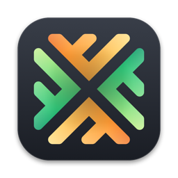</a>

<p><picture><source media="(prefers-color-scheme: light)" srcset="assets/readme/wordmark-light.svg"></picture></p>

<p>
Run Claude Code, Codex, Gemini CLI and others side by side, see at a glance which one needs you,<br>
and answer from your desk or from your phone. One native app for macOS and Windows.
</p>

<p>
<a href="#ultra-light"><picture><source media="(prefers-color-scheme: light)" srcset="assets/readme/chip-native-light.svg"></picture></a>
<a href="#ultra-light"><picture><source media="(prefers-color-scheme: light)" srcset="assets/readme/chip-no-electron-light.svg"></picture></a>
<a href="#privacy"><picture><source media="(prefers-color-scheme: light)" srcset="assets/readme/chip-no-account-light.svg"></picture></a>
<a href="#privacy"><picture><source media="(prefers-color-scheme: light)" srcset="assets/readme/chip-no-telemetry-light.svg"></picture></a>
<a href="#licence"><picture><source media="(prefers-color-scheme: light)" srcset="assets/readme/chip-free-light.svg"></picture></a>
</p>

<!-- download-buttons:start -->
<p align="center">
<a href="https://github.com/palo-kunovsky-flash/flashex-app/releases/latest/download/Flashex-macOS-arm64.dmg"><picture><source media="(prefers-color-scheme: light)" srcset="assets/readme/download-macos-light.svg"></picture></a>
<a href="https://github.com/palo-kunovsky-flash/flashex-app/releases/latest/download/Flashex-Windows-x64-setup.exe"><picture><source media="(prefers-color-scheme: light)" srcset="assets/readme/download-windows-x64-light.svg">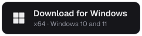</picture></a>
<a href="https://github.com/palo-kunovsky-flash/flashex-app/releases/latest/download/Flashex-Windows-arm64-setup.exe"><picture><source media="(prefers-color-scheme: light)" srcset="assets/readme/download-windows-arm64-light.svg">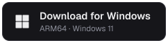</picture></a>
<br>
<a href="#macos"><picture><source media="(prefers-color-scheme: light)" srcset="assets/readme/homebrew-light.svg">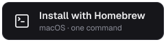</picture></a>
<a href="https://palo-kunovsky-flash.github.io/flashex-app/"><picture><source media="(prefers-color-scheme: light)" srcset="assets/readme/docs-light.svg">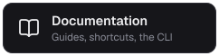</picture></a>
</p>
<p align="center"><sub>Version 0.6.1 · free to use · updates itself · <a href="#all-downloads">Linux (beta) and every file</a></sub></p>
<!-- download-buttons:end -->

<p>
<a href="#features"><picture><source media="(prefers-color-scheme: light)" srcset="assets/readme/nav-features-light.svg"></picture></a>
<a href="#install"><picture><source media="(prefers-color-scheme: light)" srcset="assets/readme/nav-install-light.svg"></picture></a>
<a href="#quick-start"><picture><source media="(prefers-color-scheme: light)" srcset="assets/readme/nav-quick-start-light.svg"></picture></a>
<a href="https://palo-kunovsky-flash.github.io/flashex-app/"><picture><source media="(prefers-color-scheme: light)" srcset="assets/readme/nav-docs-light.svg"></picture></a>
<a href="CHANGELOG.md"><picture><source media="(prefers-color-scheme: light)" srcset="assets/readme/nav-whats-new-light.svg"></picture></a>
<a href="#privacy"><picture><source media="(prefers-color-scheme: light)" srcset="assets/readme/nav-privacy-light.svg"></picture></a>
<a href="https://github.com/palo-kunovsky-flash/flashex-app/releases"><picture><source media="(prefers-color-scheme: light)" srcset="assets/readme/nav-releases-light.svg"></picture></a>
</p>

</div>

<p align="center">
<picture><source media="(prefers-color-scheme: light)" srcset="assets/readme/shots/hero-light.png">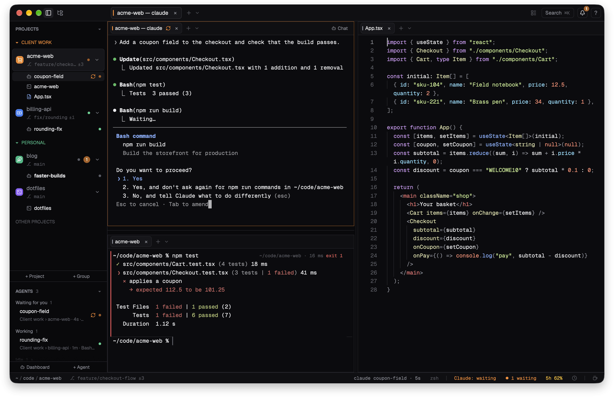</picture>
</p>

## Why Flashex

A native app built for one job: running AI agents all day. No Electron, no account, no telemetry.

<table>
<tr>
<td width="50%" valign="top">
<p><a href="#ultra-light"><picture><source media="(prefers-color-scheme: light)" srcset="assets/readme/feature-light-light.svg"></picture></a>&nbsp;&nbsp;<b>Ultra light</b></p>
<p>A native Rust app drawn on the GPU, with its own terminal core. A 30 MB download, about 77 MB of memory with a terminal open, next to no CPU when idle.</p>
</td>
<td width="50%" valign="top">
<p><a href="#agents-at-a-glance"><picture><source media="(prefers-color-scheme: light)" srcset="assets/readme/feature-agents-light.svg"></picture></a>&nbsp;&nbsp;<b>Built around agents</b></p>
<p>Every agent's state is a dot in the sidebar, a notification says what it answered or what it asks, and dashboards show sessions, usage and limits. Nine agent CLIs connect with one click.</p>
</td>
</tr>
<tr>
<td width="50%" valign="top">
<p><a href="#a-chat-over-the-agents-terminal"><picture><source media="(prefers-color-scheme: light)" srcset="assets/readme/feature-chat-light.svg"></picture></a>&nbsp;&nbsp;<b>A chat over the agent's terminal</b></p>
<p>The same session as a readable conversation, with pictures, videos and question cards. One key switches back to the terminal.</p>
</td>
<td width="50%" valign="top">
<p><a href="#flashex-on-your-phone"><picture><source media="(prefers-color-scheme: light)" srcset="assets/readme/feature-phone-light.svg"></picture></a>&nbsp;&nbsp;<b>Your agents on your phone</b></p>
<p>Follow, answer and approve from anywhere, over your own Tailscale network. Nothing is open to the internet and there is no app store.</p>
</td>
</tr>
<tr>
<td width="50%" valign="top">
<p><a href="#claude-accounts-and-limits"><picture><source media="(prefers-color-scheme: light)" srcset="assets/readme/feature-accounts-light.svg"></picture></a>&nbsp;&nbsp;<b>Limits that do not stop you</b></p>
<p>Several Claude accounts with their 5-hour and weekly limits, and a switch to the one with the most left before an agent hits a wall.</p>
</td>
<td width="50%" valign="top">
<p><a href="#agent-teams-and-chains"><picture><source media="(prefers-color-scheme: light)" srcset="assets/readme/feature-teams-light.svg"></picture></a>&nbsp;&nbsp;<b>Agents that work together</b></p>
<p>Teams and chains from a file or a window, messages between agents, tasks that wait for your approval.</p>
</td>
</tr>
<tr>
<td width="50%" valign="top">
<p><a href="#the-terminal"><picture><source media="(prefers-color-scheme: light)" srcset="assets/readme/feature-keeper-light.svg"></picture></a>&nbsp;&nbsp;<b>Terminals that do not die</b></p>
<p>A small keeper process holds your shells and agents through a quit, an update or a crash.</p>
</td>
<td width="50%" valign="top">
<p><a href="#editor-source-control-and-a-browser"><picture><source media="(prefers-color-scheme: light)" srcset="assets/readme/feature-workspace-light.svg"></picture></a>&nbsp;&nbsp;<b>The rest of your desk</b></p>
<p>An editor with language servers, Source Control with side-by-side diffs, a browser pane, a Vault for secrets and a command palette for everything.</p>
</td>
</tr>
</table>

## Features

Everything below is in the app today. The sections after the table show the big ones.

| Area | What is in it |
|---|---|
| **Agents** | State dots in the sidebar (waiting, working, idle, error) · notifications with the agent's own words, four levels, quiet hours, a schedule and mute per project or terminal · Agents, Usage and System dashboards, full or compact · a timeline of what every session did · search and resume past sessions · Send a Message Later · Keep System Awake while agents run |
| **Chat** | Chat \| Terminal over any agent's pane · pictures and videos in a gallery · questions and permissions as cards · slash commands and skills completed · paste or drop pictures · reads replies aloud, takes dictation |
| **Phone** | A web app your computer serves over Tailscale · agents as chats, terminals you type into · Allow and Deny on the notification · voice mode · quiet time · Claude accounts and Usage · teams as groups · files, diffs, dev servers, the System dashboard · three access levels per phone · paired with Touch ID or Windows Hello |
| **Claude accounts** | Every `/login` kept · limits of each account side by side · Switch without signing in again, running sessions included · automatic switch before a limit · ceilings that keep a reserve · accounts per Claude Code folder |
| **Teams** | Teams and chains from templates · each member in its own worktree · `flashex message` between agents · approvals · MCP servers per member · `flashex mcp` gives agents Flashex's tools |
| **Todos, Sync, Artifacts** | A todo list per project as a Markdown file, `flashex todo` for you and your agents · the same lists on every computer of yours, merged item by item · every page Claude publishes kept locally and shown with previews |
| **Terminal** | Its own VT core (`flashex-vt`) · command blocks with duration and exit code · inline images (kitty, sixel, iTerm2) · an input editor with history suggestions · Command History with scopes and favorites · workflows · find with regex · ssh that needs nothing on the server · remote terminals and projects over ssh · the restart keeper |
| **Workspace** | Projects and groups with icons and colours · tabs, splits, drag and drop, zoom, layouts · a file tree · an editor with tree-sitter highlighting, multi-cursor and LSP · Markdown preview · Source Control with side-by-side diffs and worktrees · a browser pane · a command palette for everything |
| **Tools** | The `flashex` command and a JSON-RPC socket · an encrypted Vault for secrets that asks before any program gets a value · Flashex's own status line for Claude Code · optional AI help with the AI you already have · themes, accents, fonts |
| **Platforms** | macOS 13+ on Apple Silicon · Windows 10 (1809+) and 11 on x64 and ARM64 · Linux beta · self-updating with signed, verified updates |

### Agents at a glance

Run as many agents as you like and never hunt for the one that waits. The sidebar lists every project's terminals and, under them, every agent grouped by state: **waiting for you**, **working**, **idle**. A pane that needs you gets an orange frame. `⌘⇧U` jumps to the oldest unread notification.

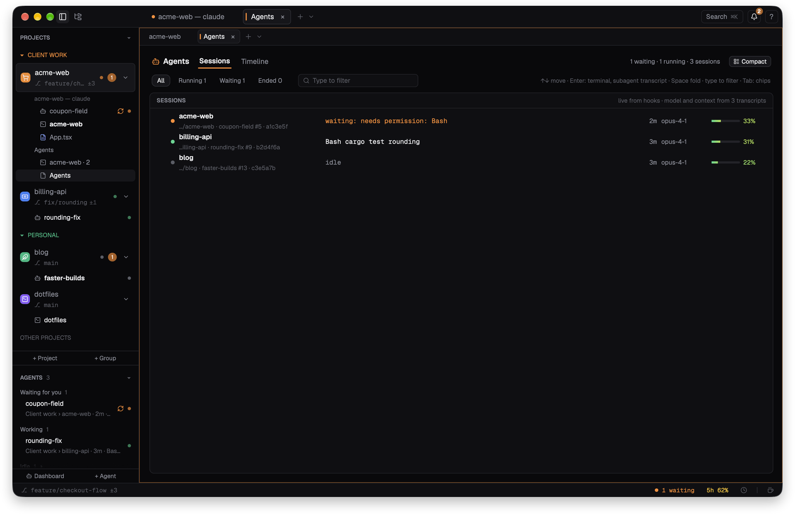

- **Notifications say what the agent said**: the start of its reply, or what it asks permission for ("Bash: npm run build"). Choose which ones pop up: Everything, Your turns, When it needs you, or Off. Quiet hours and a schedule hold them back; the bell keeps them all.
- **Dashboards as panes**: Agents (sessions and a timeline of thinking, tools and waiting), Usage (limits with pace and forecast, tokens by model, project and session) and System (CPU, GPU, memory, temperatures, disk, network). Each has a compact form for a narrow pane.
- **Search Agent Sessions…** finds any past conversation of any account and resumes it under the account it ran in.
- **Send a Message Later** types a message into one or several agents at a time you pick, for example when a limit starts over.

Nine agent CLIs connect from Settings › AI agents. Flashex writes its hooks (or plugin) into the agent's own folder, shows the change and asks first:

| Agent | State and notifications | Waits for permission | Chat | Usage |
|---|---|---|---|---|
| Claude Code | yes | yes | yes | yes, with 5-hour and weekly limits |
| Codex | yes | yes | yes | yes, with 5-hour and weekly limits |
| Gemini CLI | yes | yes | yes | yes |
| Grok Build | yes | yes | yes | yes |
| Copilot CLI | yes | yes | yes | output tokens |
| OpenCode | yes | yes | sessions run in Flashex | sessions run in Flashex |
| pi | yes | – | yes | yes |
| Antigravity CLI | yes | – | – | – |
| Cursor CLI | tools and the end of a turn | – | – | – |

Any other program can notify too: OSC 9, 777 and 99, a bell, or `flashex notify`. Flashex never answers an agent's permission question for you.

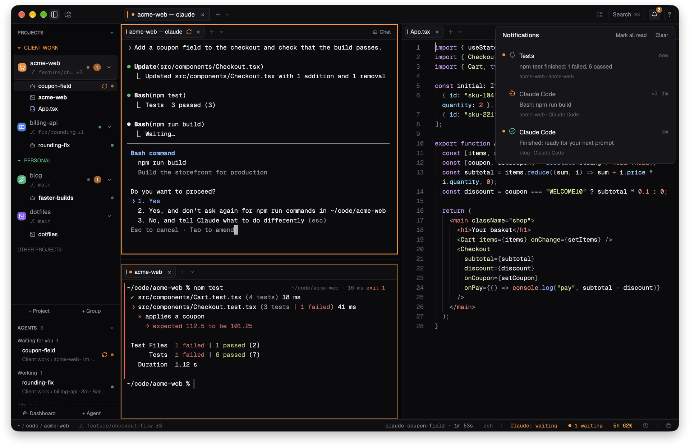

### A chat over the agent's terminal

**Chat | Terminal** in an agent's tab strip (`⌘⇧J`, `Alt+Shift+J` on Windows and Linux) shows the same session as a conversation: your prompts, the replies in rendered Markdown, each step the agent took with the first lines of what it gave, and the pictures and videos a reply names, in a gallery. A question or a permission is a card with its choices. Below it, a status band with the state, model, context, branch and subagents, and a message box that completes the agent's own slash commands and skills and takes pasted or dropped pictures. Nothing is re-implemented: what you send is typed into the real terminal.

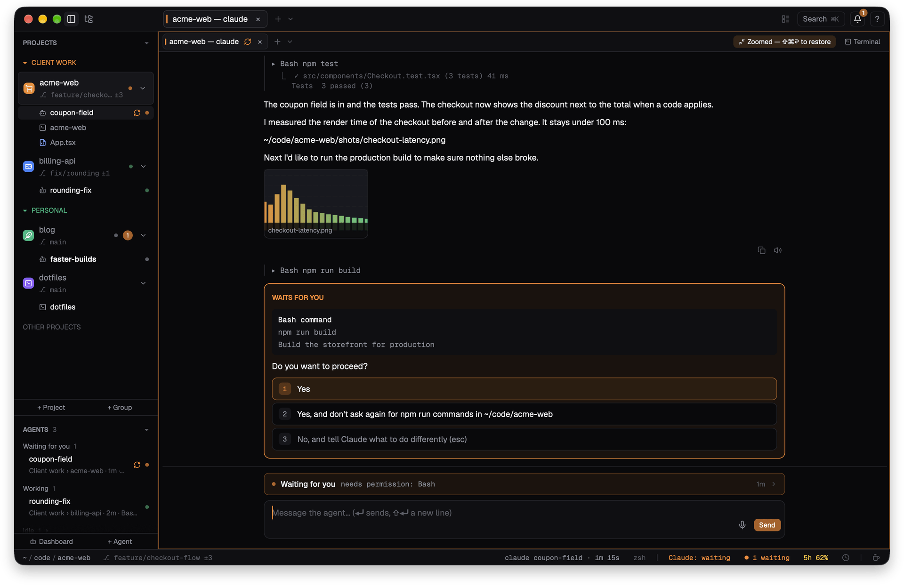

### Flashex on your phone

**Remote Access…** pairs a phone once and puts your agents in your pocket. Your computer serves a web app over [Tailscale](https://tailscale.com), so only devices in your own tailnet reach it and nothing is open to the internet. Pair by scanning the code on the computer (an eye that follows your pointer) with the phone's camera, or from the app on the home screen with its own scanner or a code you type on the computer; it updates with Flashex.

<table>
<tr>
<td align="center" width="25%">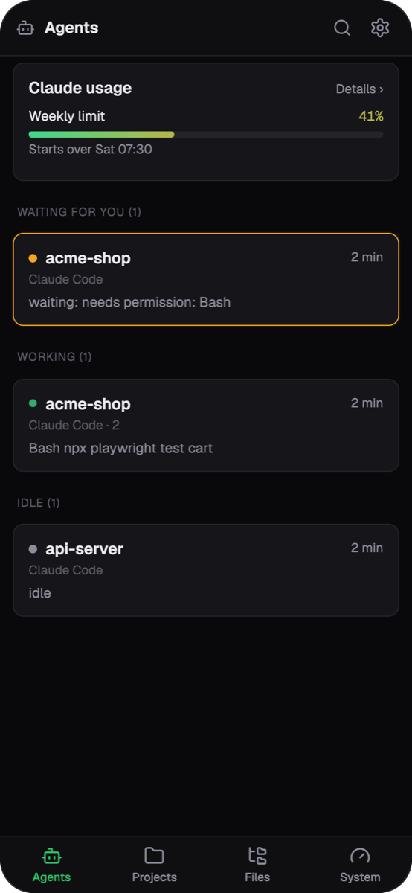<br><sub>Every agent at a glance</sub></td>
<td align="center" width="25%">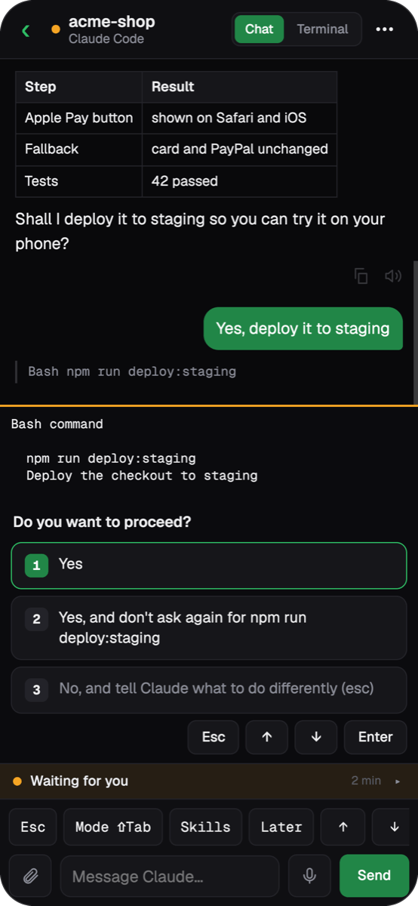<br><sub>Answer an agent's question</sub></td>
<td align="center" width="25%">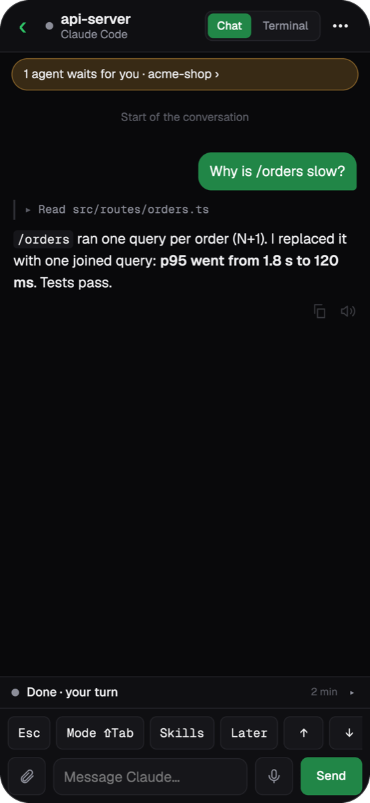<br><sub>Read and send prompts</sub></td>
<td align="center" width="25%">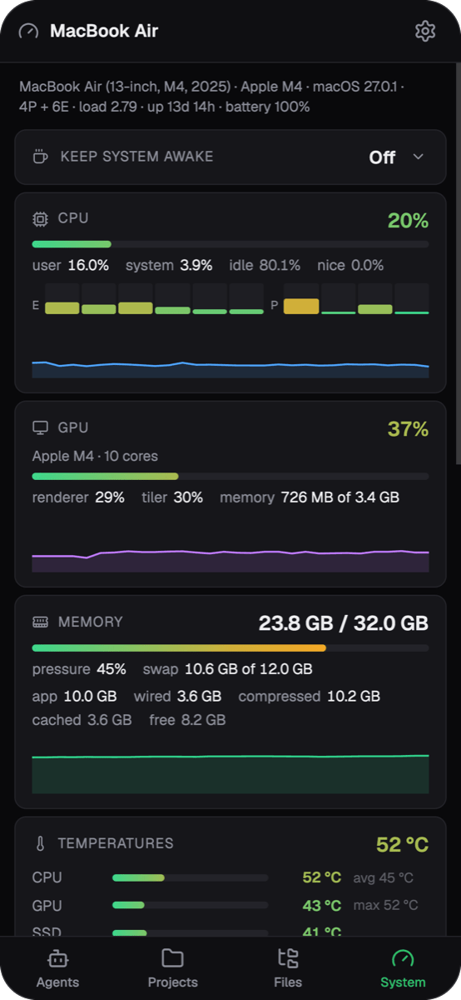<br><sub>Your computer's System</sub></td>
</tr>
</table>

- **Follow and answer**: every agent as a chat, a question as buttons, **Allow** and **Deny** right on the notification, a voice mode that reads replies and takes dictation.
- **Notifications that respect you**: only when you are away from the computer, held back in quiet time, encrypted end to end (the push service sees when, not what).
- **The rest of your desk**: terminals you type into with a key bar, Claude accounts with Switch, Usage, teams as groups, the project's files and diffs, your dev servers, the System dashboard, Keep System Awake.
- **Safe by design**: pairing needs Touch ID (Windows Hello on Windows) and a code both screens show; each phone gets **View only**, **Type in open terminals** or **Full access**; the Vault is never reachable from a phone.

Android (Chrome) and iPhone (Safari and others, from iOS 16.4), with [Tailscale](https://tailscale.com) on the phone and the computer.

### Claude accounts and limits

Have more than one Claude login? Turn on Settings › AI agents › **Switch between Claude accounts** and Flashex keeps each `/login` in the system's keychain. **Claude Accounts** lists them with their plan and their 5-hour and weekly limits, the best one to use first.

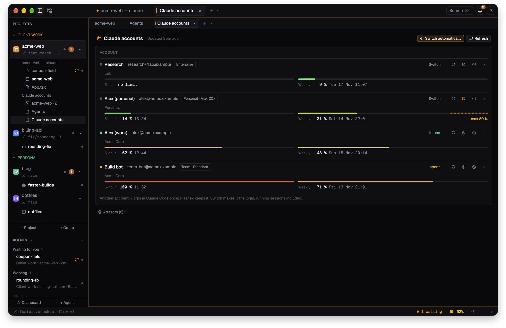

- **Switch** makes another account Claude Code's login, running sessions included, without signing in again. MCP servers stay signed in.
- **Switch automatically** (off by default) takes the account with the most left before the one in use runs out, or the moment an agent stops at its limit.
- **Ceilings** keep a share of an account for yourself; **Disable** keeps one out of the rotation.
- With several Claude Code folders (`CLAUDE_CONFIG_DIR` aliases), each folder switches between its own accounts.
- The **Usage** dashboard shows where the tokens went, and the phone shows and switches accounts too.

### Agent teams and chains

**Agent Teams…** starts several agents that know about each other: a lead with builders and a reviewer, or a chain where each block hands its result to the next. Pick a template, set each block's agent (Claude Code, Codex, Gemini CLI, Grok, pi, OpenCode, Copilot), role and task, and start.

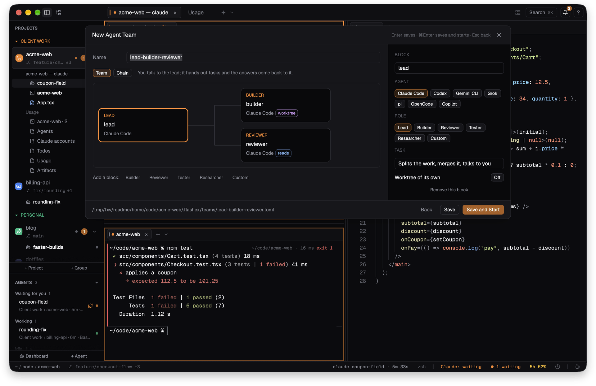

- Each member can work in **its own worktree and branch**, and is told who it is, who the others are and how to reach them.
- **`flashex message --to reviewer "…"`** puts a message in another agent's box; the answer comes back by itself. A limit of 20 messages an hour per pair stops endless loops.
- **Approvals**: a block set to "Tasks only after I approve" gets its messages only when you press Approve.
- **MCP per member**: give Jira to the lead only. **`flashex mcp`** offers Flashex's own tools (`team_message`, `team_status`, `chain_next`, `list_agents`, `artifacts`) to agents that prefer tools to commands.
- Teams are plain files in `.flashex/teams/`, so they go into git with the project.

### Todos and Sync

**Open Todos** gives every project a todo list (and an Inbox). A list is a Markdown file that you, the window and your agents all edit: `flashex todo add "…"`, `flashex todo done ID`. **Sync** keeps the lists the same on every computer of yours (Mac and PC alike), over Tailscale, merged item by item, so what you finish anywhere is finished everywhere. Computers pair once in **Remote Access › Computers**, where you also choose which one is the main one. An optional cleanup lets an agent spot the same task written twice and offers to merge.

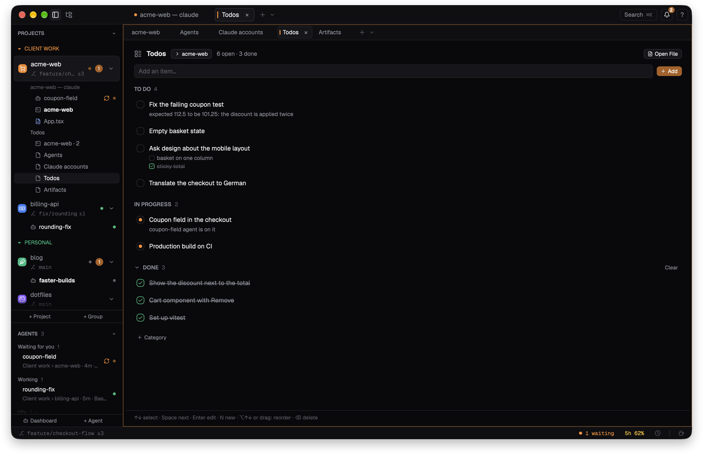

### Artifacts

Every page Claude publishes is noted and copied as it goes out, so it stays readable whichever account is in use. **Artifacts** shows them newest first with a picture of each page, search and filters by project and account; a click opens the local copy in a browser pane. `[agents] artifacts = "local"` keeps them on your computer only.

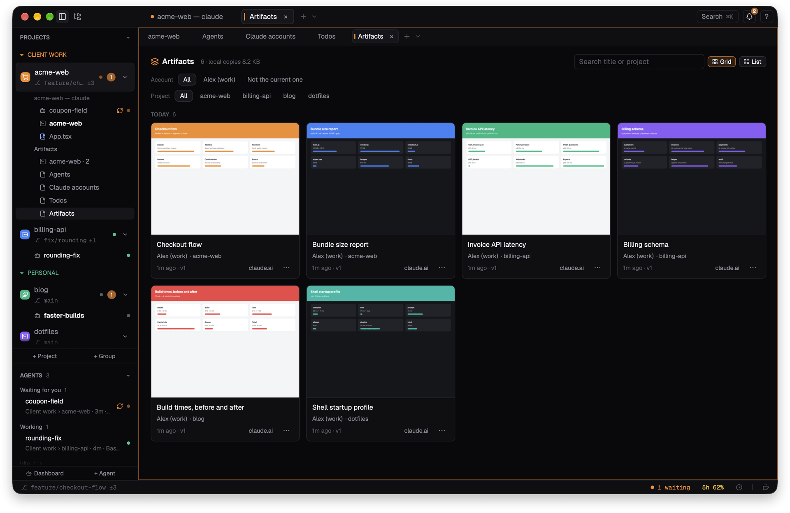

### Ultra light

Measured on the release build of 0.6.0, on an Apple M4 with macOS 27.0 (see [how](#how-the-numbers-were-measured)):

| | |
|---|---|
| Download | **30 MB** dmg · 17 MB (x64) and 15 MB (ARM64) Windows setup |
| The app on disk | 53 MB for the app's one binary (terminal core, editor, dashboards, fonts and the phone's web app included); the CLI is 1.2 MB and the keeper 1.5 MB |
| Memory, idle with one terminal | **76–78 MB** physical footprint (`vmmap`), 8 MB more for the keeper |
| Start to the first shell prompt | **about 0.15 s** on a quiet machine |
| CPU when idle | about 0.2 s of CPU time in 30 s (under 1 % of one core) |
| An extra terminal with 10,000 lines of history | about 1.5 MB |

What is not running costs nothing: no language server, browser engine or dashboard sampler starts until you use it.

<details>
<summary><b>More measurements: the terminal core, latency, editor</b></summary>

These come from the project's own development notes, measured on an Apple M4 with macOS 26 and a release build.

**The terminal core against libghostty-vt.** `flashex-vt` is written for Flashex in Rust and replaced libghostty-vt (Ghostty's VT library, which Flashex started on). The same benchmark for both: a 120×40 terminal fed 4 × 32 MiB, counting CPU instructions per input byte. Lower is better.

| Data | flashex-vt | libghostty-vt |
|---|---|---|
| ASCII text | 27.50 | 26.43 |
| Unicode (CJK, emoji, combining) | 103.93 | 104.16 |
| SGR-heavy (colours and styles every few characters) | 114.50 | 223.67 |

**Conformance** (esctest2, VT level 5, 567 tests): flashex-vt passes **450**, libghostty-vt 272 in the same harness. The remaining failures are deliberate choices (a program may write the clipboard but never read it, may not move the window, and so on).

**Fuzzing**: hour-long runs of a structured fuzzer (escape sequences, resizes, selection, keys, mouse, inline images; 270 million operations and more per run) ended with no crash, no hang and bounded memory.

| Measurement | Result |
|---|---|
| Key → frame ready (terminal core) | median 71–74 µs |
| Frame build during animations | under 4.5 ms, typically 0.3–2 ms |
| One terminal core with 10,000 lines of history | 1.47 MB (libghostty-vt: 10.70 MB) |
| A 1,000,000-line history | 93 MB, about 93 bytes per line |
| Open a 10,000-line file in the editor | 0.33–0.38 ms |
| Keystroke → new syntax tree, 15,000 lines of Rust | 0.65–0.81 ms |
| Keystroke in a 10 MB file | 3.4 ms |

</details>

### The terminal

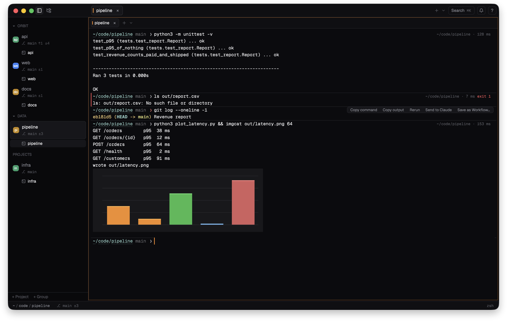

- **Command blocks.** Shell integration for zsh, bash, fish and PowerShell turns every command into a block with its folder, duration and exit code. Jump between blocks, fold one, copy its output, rerun it, send it to an agent or save it as a workflow.
- **Inline images.** kitty graphics, sixel and iTerm2 images are drawn in place and scroll with the text. A printed picture path previews on hover.
- **The restart keeper.** Terminals survive quitting Flashex, an update and a crash: a tiny helper holds the shells and their output, and the next start takes them back with the same processes.
- **Flashex's status line for Claude Code.** Settings › AI agents can draw Claude Code's status line in the app's colours: model, branch, context and both limits as meters. Your own status line stays outside Flashex.

  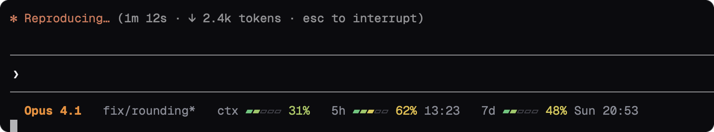
- **Command History** (`⌘⌥R`) in five scopes: this folder, this project, all, frequent, favorites. Lines that look like secrets are masked.
- **Your own history per terminal.** Up and Down bring back this window's own commands, not every shell's.
- **ssh and remote.** `ssh server` just works with nothing installed there. **Open Remote Terminal…** keeps a terminal running on the host through dropped connections, and **New Remote Project…** opens a remote folder with its files, Git and language servers.
- **The `flashex` command** drives the app from scripts and agents: `flashex split right`, `flashex send --to bubbles 'run the tests\n'`, `flashex read --last-block`, `flashex open src/main.rs:10`, `flashex events`, `flashex todo`, `flashex team`, `flashex vault run`. The same JSON-RPC API is on a socket only your user can open. [All commands](https://palo-kunovsky-flash.github.io/flashex-app/cli.html)

### Editor, Source Control and a browser

No need to leave for a quick edit or a diff.

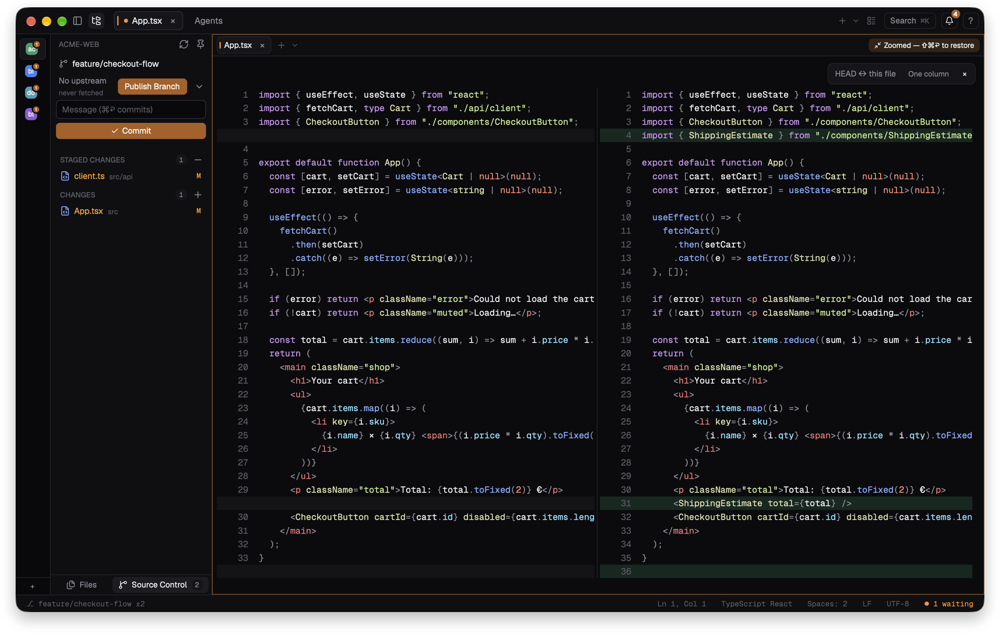

- **Editor**: tree-sitter highlighting for 15 languages, multiple cursors, a minimap, `⌘P` to open files, Format Document, and key profiles in the style of Sublime Text and VS Code. Language servers already on your system (rust-analyzer, typescript-language-server, pyright, gopls, …) give diagnostics, go to definition, references, hover, completion and rename. Markdown renders side by side.
- **Source Control**: stage, unstage, discard, commit with your own git config, pull, push, switch branches, worktrees, and side-by-side diffs against HEAD.
- **Browser pane**: `⌘⇧B` opens a browser beside your terminals; a `localhost` link or a project's dev server chip opens there. It also shows local HTML, SVG and PDF files.
- **Vault**: API keys, logins and SSH keys in one encrypted file. `flashex vault run -- deploy` puts secrets in a command's environment after you allow it, so an agent never reads one silently.
- **Projects and panes**: groups, icons and colours; drag panes to split or join them as tabs; each pane has its own text size; layouts are saved as templates and the whole session comes back at the next start.

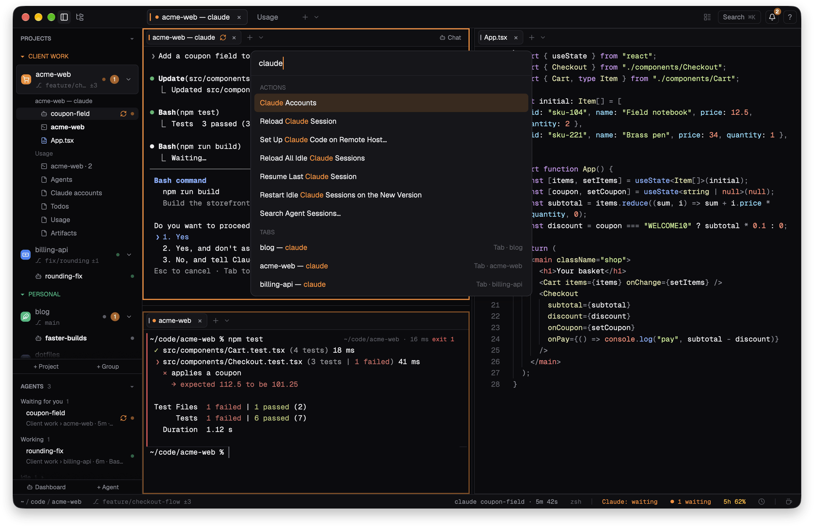

## Install

A button at the top downloads the newest version for your system, and installed copies update themselves.

### macOS

Apple Silicon (M1 or later), macOS 13 Ventura or later. Intel Macs are not supported.

```sh
brew install --cask palo-kunovsky-flash/flashex/flashex
```

Homebrew installs `Flashex.app`, links the `flashex` command and lets the app open normally the first time. Or download [`Flashex-macOS-arm64.dmg`](https://github.com/palo-kunovsky-flash/flashex-app/releases/latest/download/Flashex-macOS-arm64.dmg) (always the latest version), drag **Flashex** to **Applications**, and **the first time** right-click it and choose **Open**, or run:

```sh
xattr -dr com.apple.quarantine /Applications/Flashex.app
```

Why that step? Flashex is free and made by one developer without a paid Apple Developer account, so it is not notarized and Gatekeeper asks once. Updates do not ask again. After a dmg install, `ln -s /Applications/Flashex.app/Contents/MacOS/flashex /opt/homebrew/bin/flashex` puts the `flashex` command on your `PATH` (inside a Flashex terminal it is always there).

### Windows

Windows 10 (1809 or later) or Windows 11, x64 or ARM64.

1. Download the setup for your PC with a button at the top of this page (or from [All downloads](#all-downloads)): **x64** for most PCs, **ARM64** for Snapdragon laptops.
2. Run it. It installs for you only (no administrator), adds Flashex to the Start menu and **Open in Flashex** to Explorer's menu on folders.
3. **The first time**, SmartScreen may say "Windows protected your PC": choose **More info**, then **Run anyway**. The setup is not signed with a paid certificate yet; updates do not ask again.

The browser pane uses WebView2, which comes with Windows 11 and every updated Windows 10. Terminals run PowerShell 7 when it is installed (else Windows PowerShell); Git Bash and cmd work too. Shortcuts use Ctrl where the Mac uses Cmd, and Ctrl+Shift with a letter for Flashex's own (`Ctrl+Shift+P` palette, `Ctrl+Shift+T` new tab), so Ctrl with a letter stays the shell's. `Ctrl+C` copies a selection, else stops the program.

### Linux (beta)

x86_64 or arm64, glibc 2.35 or later (Ubuntu 22.04, Debian 12, Fedora 36 and newer), X11 or Wayland. Take the AppImage (updates itself), the `.deb` or the `.tar.gz` from [All downloads](#all-downloads). The Linux build is at an older version than macOS and Windows and has no browser pane yet.

### All downloads

Every file of every system, with the newest version each has:

<!-- downloads:start -->
| System | Version | Download |
|---|---|---|
| **macOS** · Apple Silicon · 13+ | 0.6.1 | [**Flashex-macOS-arm64.dmg**](https://github.com/palo-kunovsky-flash/flashex-app/releases/latest/download/Flashex-macOS-arm64.dmg) · or `brew install --cask palo-kunovsky-flash/flashex/flashex` |
| **Windows** 10 1809+ / 11 · x64 | 0.6.1 | [**Flashex-0.6.1-windows-x86_64-setup.exe**](https://github.com/palo-kunovsky-flash/flashex-app/releases/download/v0.6.1/Flashex-0.6.1-windows-x86_64-setup.exe) |
| **Windows** 11 · ARM64 | 0.6.1 | [**Flashex-0.6.1-windows-aarch64-setup.exe**](https://github.com/palo-kunovsky-flash/flashex-app/releases/download/v0.6.1/Flashex-0.6.1-windows-aarch64-setup.exe) |
| **Linux** (beta) · x86_64 | 0.3.2 | [AppImage](https://github.com/palo-kunovsky-flash/flashex-app/releases/download/v0.3.2/Flashex-0.3.2-linux-x86_64.AppImage) · [.deb](https://github.com/palo-kunovsky-flash/flashex-app/releases/download/v0.3.2/flashex_0.3.2_amd64.deb) · [.tar.gz](https://github.com/palo-kunovsky-flash/flashex-app/releases/download/v0.3.2/flashex-0.3.2-linux-x86_64.tar.gz) |
| **Linux** (beta) · arm64 | 0.3.2 | [AppImage](https://github.com/palo-kunovsky-flash/flashex-app/releases/download/v0.3.2/Flashex-0.3.2-linux-aarch64.AppImage) · [.deb](https://github.com/palo-kunovsky-flash/flashex-app/releases/download/v0.3.2/flashex_0.3.2_arm64.deb) · [.tar.gz](https://github.com/palo-kunovsky-flash/flashex-app/releases/download/v0.3.2/flashex-0.3.2-linux-aarch64.tar.gz) |
| **Phone** (Android, iPhone) | – | the web app your computer serves: [Flashex on your phone](#flashex-on-your-phone) |
<!-- downloads:end -->

### Updates

Flashex checks GitHub for a new release at start and once a day, and offers it in a card with its release notes. Nothing is downloaded until you choose **Update**. Every update is verified before it replaces anything: a manifest signed with the project's own key (its public half is built into the app), the exact size and SHA-256 of the download, and the new app's version. Your terminals keep running through the update. `[updates] check = false` turns the check off.

Each release also ships a `.sha256` next to every file, to check a download yourself:

```sh
shasum -a 256 -c Flashex-<version>.dmg.sha256
```

## Quick start

1. **Open a folder as a project**: `⌘O` (or **Open Folder…** on the welcome card). Its terminals, files and agents stay together and come back after a restart.
2. **Connect your agent**: Settings › AI agents › **Claude Code hooks** (or `flashex setup claude` in a terminal). It shows the change and asks first. Codex, Gemini CLI and the others have a row of their own.
3. **Run it**: type `claude` in a terminal. Its dot appears in the sidebar; when it waits for you, you will know.
4. **Try the chat**: `⌘⇧J` over the agent's terminal (`Alt+Shift+J` on Windows and Linux).
5. **Find anything**: `⌘K` opens the command palette (`Ctrl+Shift+P` on Windows and Linux). Type "todos", "claude accounts", "agent teams", "artifacts", "remote access".
6. **Take it with you**: **Remote Access…** pairs your phone with a QR code.

The welcome card and a five-tip tour show the same on the first start; both close with Esc. `⌘?` lists every shortcut as your computer writes it.

The [documentation](https://palo-kunovsky-flash.github.io/flashex-app/) goes deeper: [working with agents](https://palo-kunovsky-flash.github.io/flashex-app/agents.html), [the `flashex` command](https://palo-kunovsky-flash.github.io/flashex-app/cli.html), [configuration](https://palo-kunovsky-flash.github.io/flashex-app/configuration.html), [every shortcut](https://palo-kunovsky-flash.github.io/flashex-app/shortcuts.html) and [troubleshooting](https://palo-kunovsky-flash.github.io/flashex-app/troubleshooting.html).

Settings (`⌘,`) edits `~/.config/flashex/config.toml`, a commented file that Flashex applies as soon as you save it; `keybindings.toml` next to it changes any shortcut.

## Privacy

Flashex has **no telemetry, no analytics, no account and no crash reporting**. Your terminals, transcripts, todos, artifacts and secrets stay on your computer. These are all the network connections it makes:

| What | When | Where to |
|---|---|---|
| Update check | at start and once a day (`[updates] check`) | `api.github.com`, this repository's latest release; the download only when you choose Update |
| What's New and release notes | when an update is offered or installed | this repository's `CHANGELOG.md` on GitHub |
| Browser pane | pages you open | those pages; text that is no address is searched with DuckDuckGo (`[browser] search_url`) |
| Git | fetch, pull, push that you start | your remotes, with your own git and credentials |
| Claude account limits | only with the account switcher or `[agents] usage_api` turned on | `api.anthropic.com`, with that account's own Claude Code login, to read its usage |
| Claude status card | only if you turn it on (`[agents] claude_status`) | `status.claude.com`, Anthropic's public status page |
| Public IP in System | only if you turn it on (`[dashboards] public_ip`) | `api.ipify.org` |
| AI help | only when you press Enter on a `#` line or click Explain, Fix or Send to AI… | the agent CLI or server you chose, which may be a local model |
| Remote Access (phones, and Sync between your computers) | only when you turn them on, each on its own | your own devices, through Tailscale; phone notifications go through Google's or Apple's push service, encrypted end to end |
| Remote terminals | hosts you type | through your own `ssh` |

Agents, language servers and other programs you run in Flashex make their own connections, as in any terminal. The hooks Flashex installs for an agent only tell the app on your computer what the agent does; they send nothing anywhere.

Details worth knowing: the `flashex` socket is open to your user only; programs in a terminal can write the clipboard but never read it; command lines that look like they hold a secret are never saved; the Vault is encrypted with XChaCha20-Poly1305 under an Argon2id key and is never reachable from a phone; `[privacy] hide_host` and `hide_emails` hide your computer's name and account e-mails for screenshots. The [privacy page](https://palo-kunovsky-flash.github.io/flashex-app/privacy.html) lists exactly what each feature reads and sends.

## How the numbers were measured

The table under [Ultra light](#ultra-light) was measured on 2026-11-11 with a build of 0.6.0 made with the release profile, on an Apple M4 (32 GB) with macOS 27.0, in a fresh, empty home folder (no shell configuration, one window, one terminal):

- **Sizes** are the files of the 0.6.0 release and of the built app.
- **Memory** is the `Physical footprint` line of `vmmap --summary` 25 seconds after start, in two runs (77.6 and 76.1 MB; the resident size, which counts shared system libraries too, was 93–111 MB). The keeper is its resident size.
- **CPU** is the process's CPU time (`ps -o cputime`) before and after 30 idle seconds: 0.17 s and 0.22 s in two runs.
- **Start** is `--measure-startup`, the time from launch to the first shell prompt, median of 5 runs after a warm-up. On that day the machine was running several large builds (load average near 200) and the medians were 616 ms and 996 ms; the 0.15 s is the median on a quiet machine (148 ms), measured the same way in October 2026 with version 0.2. Your own shell configuration adds its time on top.
- **An extra terminal** and the numbers under "More measurements" are from the project's development notes (October 2026), measured with its benchmark programs.

## Support Flashex

Flashex is free, and the best support costs nothing:

- **Star** [this repository](https://github.com/palo-kunovsky-flash/flashex-app). It helps other people find Flashex.
- **Tell a friend** or a colleague who works with AI agents.
- **Report bugs and share ideas** in [Issues](https://github.com/palo-kunovsky-flash/flashex-app/issues). A clear report with steps to reproduce it is worth a lot.

## Licence

Flashex is **free to use**, for personal and commercial work. It is **closed source**: this repository holds the README, the documentation, the screenshots and the releases, not the code. The terms are in [LICENSE](LICENSE). Flashex is provided as is, without warranty.

Flashex includes open-source software: the Geist and Geist Mono fonts (SIL Open Font License 1.1), Symbols Nerd Font (MIT), Lucide icons (ISC) and Rust crates under MIT, Apache-2.0, BSD, Zlib, Unicode, MPL-2.0 and similar licences. Every component and its licence text is listed in [THIRD_PARTY_NOTICES.md](THIRD_PARTY_NOTICES.md).
